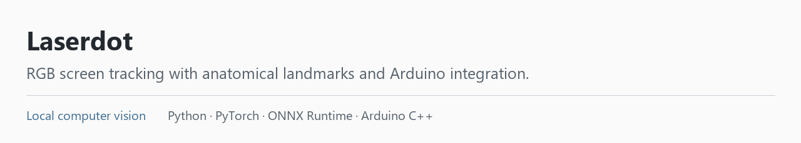
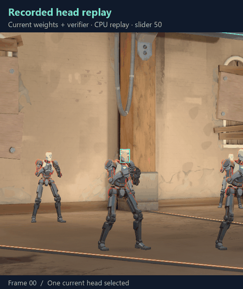
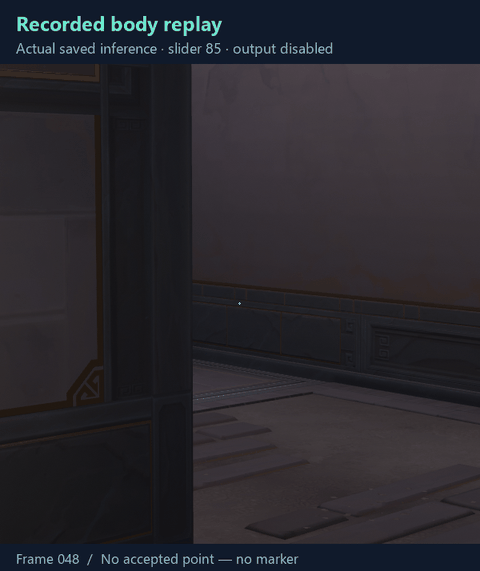
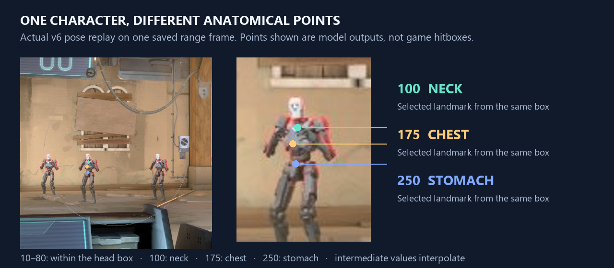
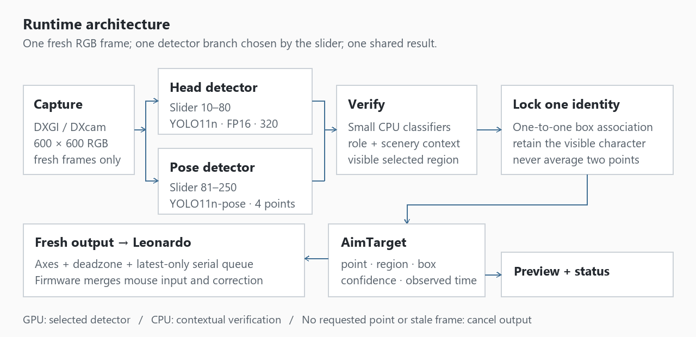
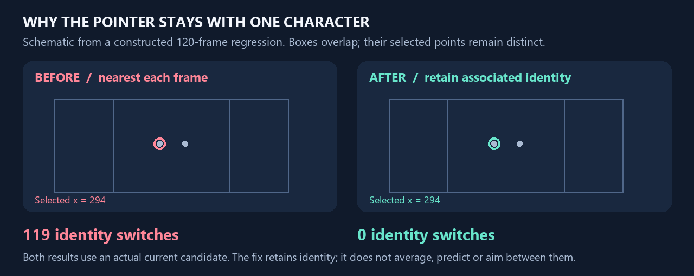
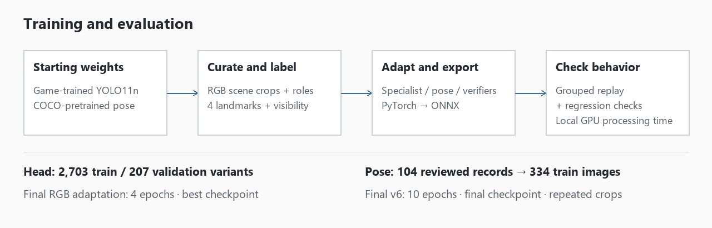
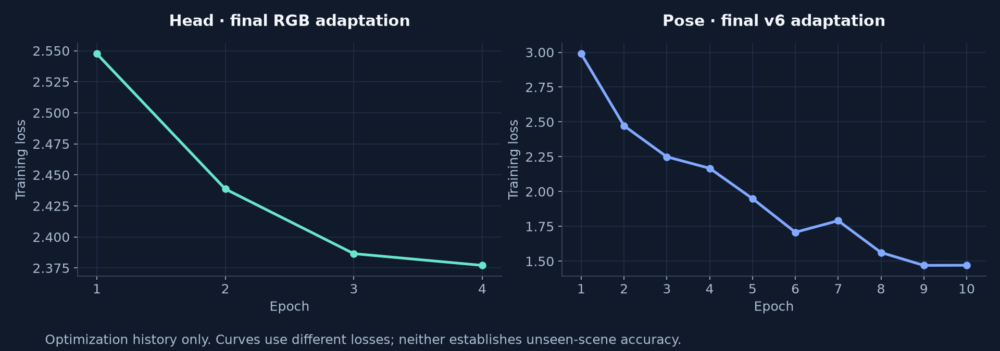

Laserdot tracks a selected anatomical point in Valorant practice/custom-game scenes. Python processes RGB screen crops locally; an Arduino Leonardo and USB host shield combine mouse input with the resulting correction.

**Python · PyTorch · Ultralytics YOLO11 · ONNX Runtime/CUDA · Tkinter · Arduino C++**

Audited **8 October 2026**. [Model details](MODELS.md) · [Evidence](EVALUATION.md) · [Credits](CREDITS.md)

## The problem

A colour-based prototype confused shoulders, walls and effects with heads. AI introduced different problems: teammate classification, small-target recall, selection between nearby characters and stale frames under load. The engineering work connected detection, anatomy, identity and output timing.

## Tracker in action

| Head branch | Body branch |
| --- | --- |
|  |  |
| Current head model and verifier replayed on 60 recorded frames. Teal boxes are accepted heads; gold marks the selected point. CPU replay disables the search time budget. | A contiguous recorded real-agent sequence, replayed at slider 85. Gold marks the accepted lower-head/neck point; missing observations leave no marker. |

Both use approximate recorded timing, quantized to GIF ticks. They demonstrate observations, not inference speed, successful shots or general accuracy. Arduino output was disabled.

The slider preserves **10–80 head-box placement**, then uses pose landmarks: **100 neck, 175 chest, 250 stomach**. Intermediate values interpolate within one character. Above are actual v6 outputs on one saved frame: screen-space points, not engine hitboxes.

## Architecture

- **Select a region.** Body mode can select a visible chest without detecting a head. Missing/rejected requested landmarks cancel output without substituting the head.
- **Verify context.** Small CPU classifiers check character/role/background evidence. Explicit friendly UI and colour cues add rejection checks; the pipeline is not entirely colour-rule-free.
- **Keep one identity.** Box geometry associates candidates one-to-one. A visible lock wins over a nearer neighbour. Missing observations stop movement while identity is remembered briefly.
- **Use fresh results.** Preview, status and movement consume one `AimTarget`. Latest-only queues and age checks prevent a backlog of old observations; branch changes cancel pending output.

This **constructed** regression alternates which character is nearer: **119 switches → 0 over 120 frames**. Outputs remain one character's current point. Playback is slowed; live two-enemy behavior was not validated.

## Models and training

| Detector | Parameters | Starting point | Runtime |
| --- | ---: | --- | --- |
| Head specialist — YOLO11n | 2,590,230 | Externally game-trained nano checkpoint, followed by local adaptations | RGB 320, FP16 ONNX, CUDA |
| Four-landmark body — YOLO11n-pose | 2,662,458 | COCO-pretrained pose checkpoint; adapted to enemy/teammate roles and four landmarks | RGB 320, FP32 ONNX, CUDA |

Context verifiers add **862,246** head, **468,579** primary body and **337,507** secondary body parameters. Related crops retain their recording-group partition. Counts include repeated/augmented variants. The [model card](MODELS.md) covers lineage, losses, labels and selection.

## Measured results and limits

| Saved result | What it measures |
| --- | --- |
| **156 regression tests passed** | Software behavior in the recorded recovery test run |
| **33.2 ms p95** on RTX 2070 | Body processing on 100 saved-scene samples; excludes capture-to-USB latency |
| **0 selections / 664 designated negative checks** | One reused regression set; broader background failures remain |

The body model **has not passed full qualification**. Distant chest/stomach recall, concealed-region rejection and background cases remain unresolved. Training-list metrics are not held-out accuracy. [Exact scopes and failures](EVALUATION.md).

Development combined recorded-scene debugging, reviewed labels, transfer learning, hardware integration and regression tests, with AI-assisted coding/research. Weights, raw datasets and runtime binaries are excluded from this documentation showcase. Open [preview.html](preview.html) locally for the presentation.
